# Evidencias de las pruebas

Capturas de la consola de los 17 casos de prueba ejecutados sobre el programa (fecha usada: 2026-11-01). Resultado: **17 de 17 cumplen**.

| Caso | Tipo | Prueba | Resultado | Captura |
|---|---|---|---|---|
| CP-01 | Normal | Registrar un producto con datos válidos | Cumple | [CP-01.png](CP-01.png) |
| CP-02 | Normal | Consultar un producto existente | Cumple | [CP-02.png](CP-02.png) |
| CP-03 | Normal | Modificar el precio de un producto | Cumple | [CP-03.png](CP-03.png) |
| CP-04 | Normal | Registrar una entrada de inventario | Cumple | [CP-04.png](CP-04.png) |
| CP-05 | Normal | Venta válida: subtotal, IVA y total | Cumple | [CP-05.png](CP-05.png) |
| CP-06 | Normal | Venta con varios productos y actualización de las listas | Cumple | [CP-06.png](CP-06.png) |
| CP-07 | Excepcional | Intentar registrar un código duplicado | Cumple | [CP-07.png](CP-07.png) |
| CP-08 | Excepcional | Ingresar precio y cantidad negativos | Cumple | [CP-08.png](CP-08.png) |
| CP-09 | Excepcional | Ingresar datos de tipo incorrecto | Cumple | [CP-09.png](CP-09.png) |
| CP-10 | Excepcional | Intentar vender más unidades de las disponibles | Cumple | [CP-10.png](CP-10.png) |
| CP-11 | Excepcional | Consultar un producto inexistente | Cumple | [CP-11.png](CP-11.png) |
| CP-12 | Excepcional | Intentar vender un producto desactivado | Cumple | [CP-12.png](CP-12.png) |
| CP-13 | Excepcional | Elegir una opción inválida en los menús | Cumple | [CP-13.png](CP-13.png) |
| CP-14 | Excepcional | Venta cancelada y carrito vacío | Cumple | [CP-14.png](CP-14.png) |
| CP-15 | Cálculo | Reportes de ventas: historial, total de ingresos y producto más vendido | Cumple | [CP-15.png](CP-15.png) |
| CP-16 | Cálculo | Reportes de inventario: listado, stock mínimo, valor del inventario y promedio por mes | Cumple | [CP-16.png](CP-16.png) |
| CP-17 | Cálculo | Verificación directa de los cálculos con datos de dos meses | Cumple | [CP-17.png](CP-17.png) |

## Detalle de cada caso

### CP-01 - Registrar un producto con datos válidos

- **Datos utilizados:** Código P001; nombre Cuaderno; categoría Papeleria; precio 25.5; cantidad 20; stock mínimo 5
- **Resultado esperado:** El sistema muestra “Producto registrado”, agrega el producto activo a la lista y registra un movimiento ENTRADA de 20 unidades (inventario inicial).
- **Resultado obtenido:** Mensaje: “Producto registrado”. Listado: P001 | Cuaderno | Papeleria | Precio: 25.5 | Cantidad: 20 | Minimo: 5 | Activo. Lista productos = [['P001', 'Cuaderno', 'Papeleria', 25.5, 20, 5, True]]. Movimientos = [['2026-11-01', 'P001', 'ENTRADA', 20, 'Inventario inicial']].
- **Conclusión:** Cumple. El producto se registró con todos sus datos y quedó activo.

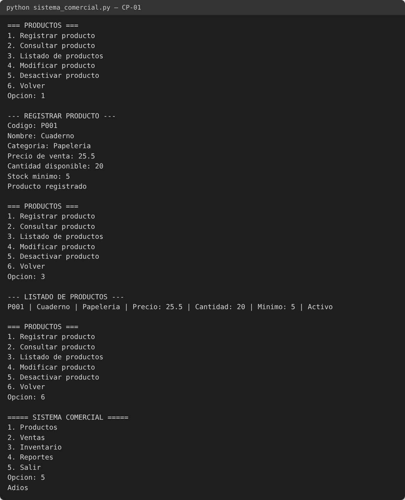

### CP-02 - Consultar un producto existente

- **Datos utilizados:** Código a consultar: P001 (registrado antes)
- **Resultado esperado:** El sistema muestra los siete datos del producto: código, nombre, categoría, precio, cantidad, stock mínimo y estado Activo.
- **Resultado obtenido:** Se mostraron: Codigo: P001; Nombre: Cuaderno; Categoria: Papeleria; Precio: 25.5; Cantidad: 20; Stock minimo: 5; Estado: Activo.
- **Conclusión:** Cumple. La consulta por código devuelve la información completa del producto.

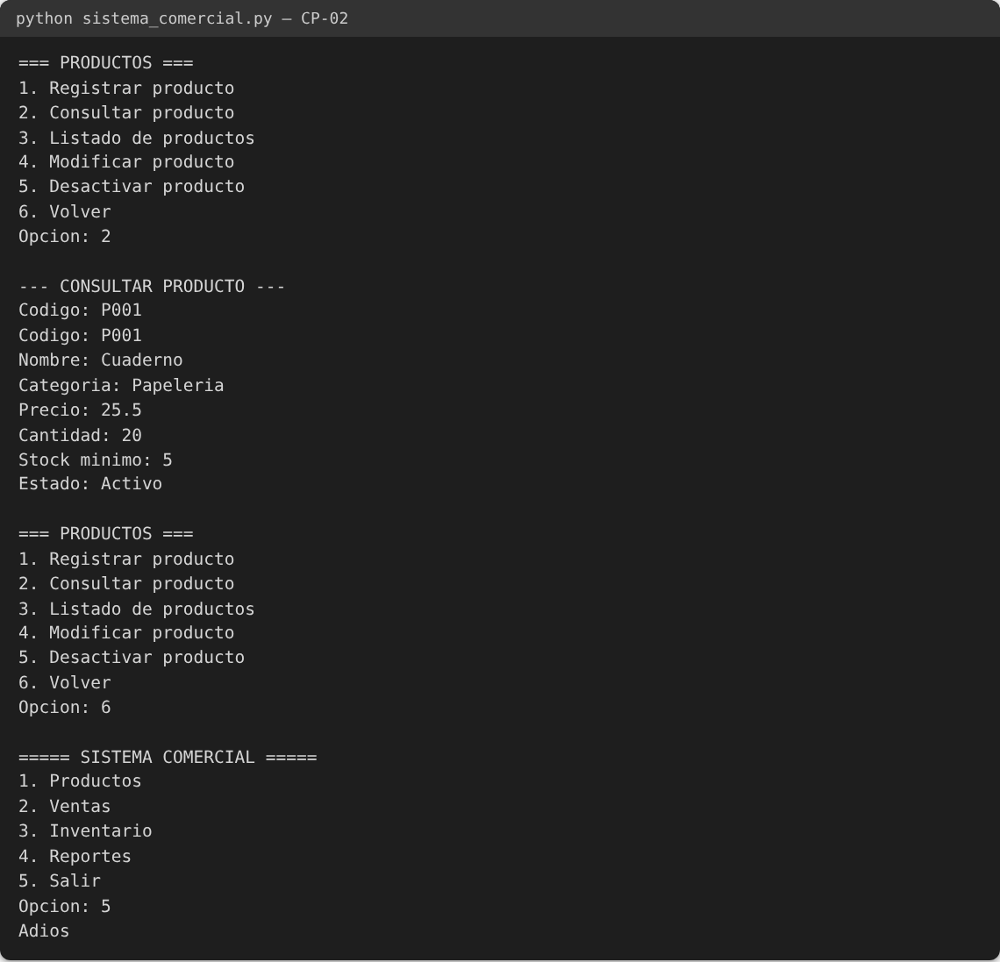

### CP-03 - Modificar el precio de un producto

- **Datos utilizados:** Código P001; opción 3 (precio); nuevo precio 30
- **Resultado esperado:** El sistema muestra “Listo” y el producto queda con precio 30.0; la consulta posterior lo confirma.
- **Resultado obtenido:** Mensaje: “Listo”. La consulta posterior muestra: Precio: 30.0. Precio en la lista = 30.0.
- **Conclusión:** Cumple. El cambio de precio se aplicó y se conservó en la lista.

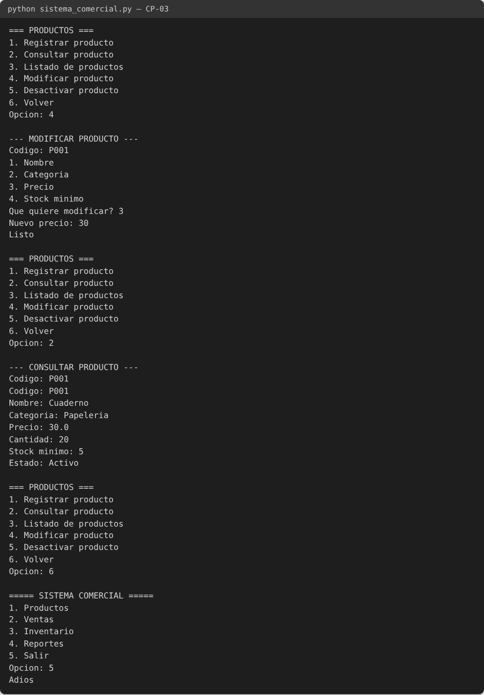

### CP-04 - Registrar una entrada de inventario

- **Datos utilizados:** Código P001 (20 unidades); cantidad que entra 15; descripción “compra a proveedor”
- **Resultado esperado:** La existencia sube de 20 a 35 y se registra un movimiento ENTRADA de 15 unidades con la descripción escrita.
- **Resultado obtenido:** Entrada registrada. Nueva cantidad: 35. Existencias: P001 | Cuaderno | Cantidad: 35. Último movimiento = ['2026-11-01', 'P001', 'ENTRADA', 15, 'compra a proveedor'].
- **Conclusión:** Cumple. La entrada actualizó la existencia y quedó registrada en el historial.

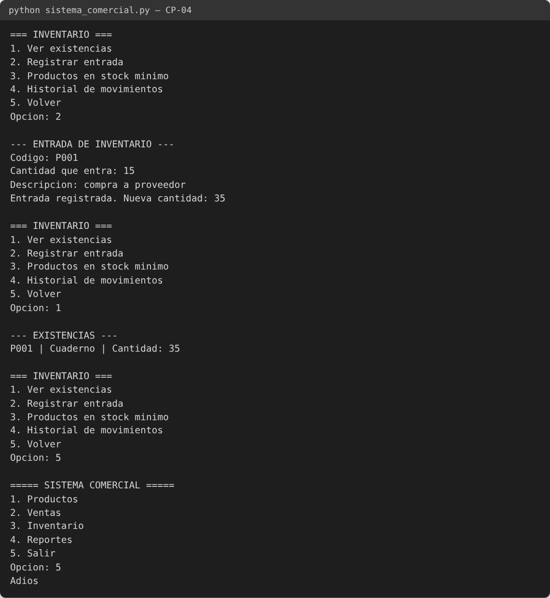

### CP-05 - Venta válida: subtotal, IVA y total

- **Datos utilizados:** P001 con precio 25.5 y 20 unidades; se vende 1 producto: P001 × 4; confirma con “s”
- **Resultado esperado:** Subtotal = 25.5 × 4 = 102.0; IVA 12 % = 12.24; Total = 114.24; venta No. 1; la existencia baja de 20 a 16.
- **Resultado obtenido:** Resumen: Subtotal: Q 102.0; IVA 12%: Q 12.24; Total: Q 114.24. Venta guardada = [[1, '2026-11-01', 102.0, 12.24, 114.24]]. Existencia de P001 = 16.
- **Conclusión:** Cumple. Los cálculos coinciden con el resultado hecho a mano y el inventario se actualizó.

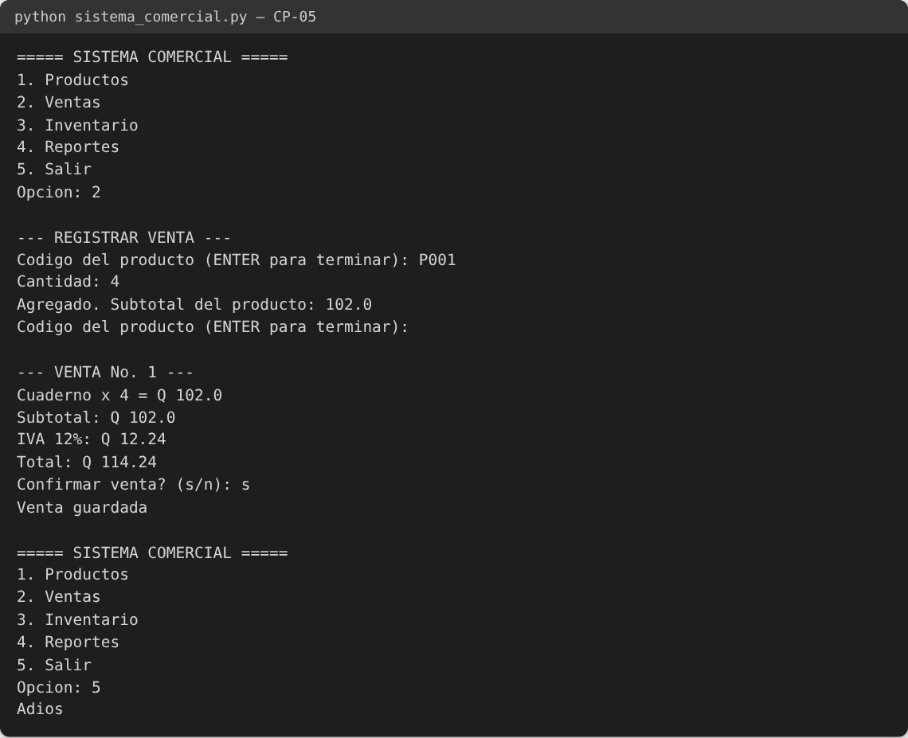

### CP-06 - Venta con varios productos y actualización de las listas

- **Datos utilizados:** P001 (25.5, 20 unidades) y P003 (4.0, 15 unidades); se vende P001 × 2 y P003 × 5; confirma con “s”
- **Resultado esperado:** Subtotales 51.0 y 20.0; subtotal general 71.0; IVA 8.52; total 79.52. Existencias: P001 = 18 y P003 = 10. Dos movimientos SALIDA y dos renglones en el detalle de la venta.
- **Resultado obtenido:** Resumen: Subtotal: Q 71.0; IVA 12%: Q 8.52; Total: Q 79.52. Detalle = [[1, 'P001', 2, 51.0], [1, 'P003', 5, 20.0]]. Existencias: P001 = 18, P003 = 10. Movimientos SALIDA = 2.
- **Conclusión:** Cumple. Los totales son correctos y las listas de productos, detalle y movimientos quedaron actualizadas.

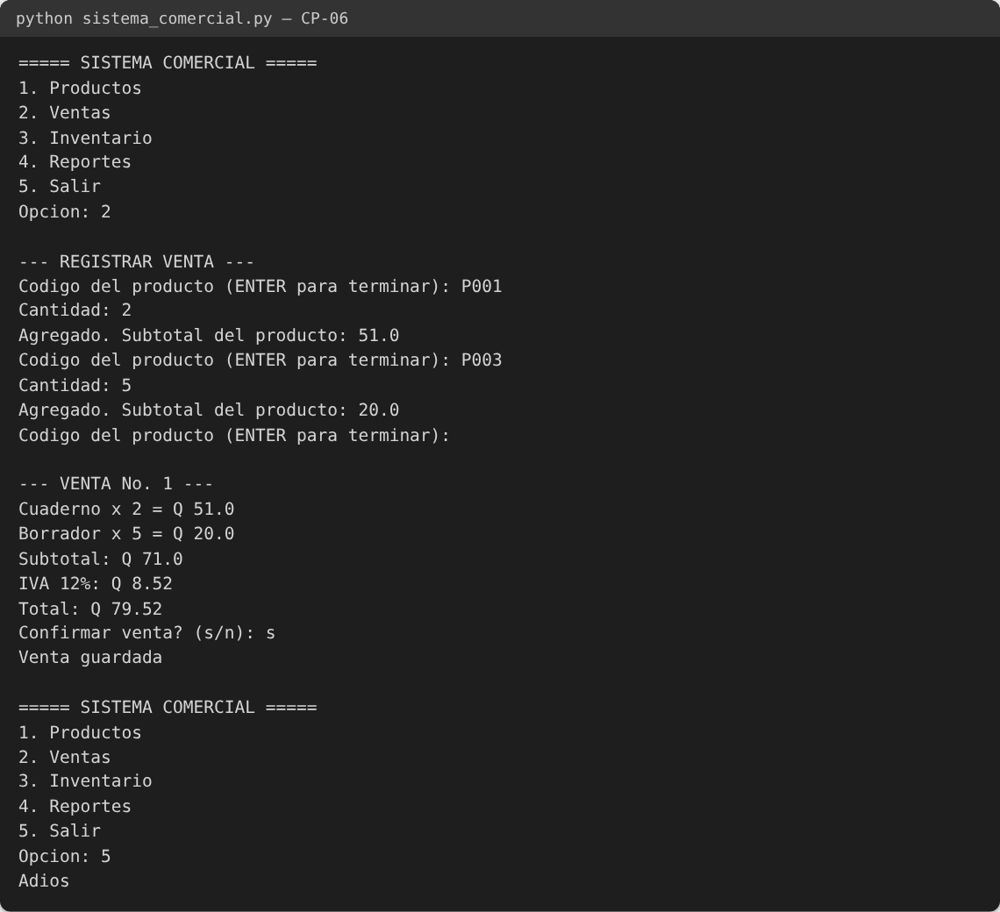

### CP-07 - Intentar registrar un código duplicado

- **Datos utilizados:** P001 ya registrado; se intenta registrar otra vez el código P001
- **Resultado esperado:** El sistema muestra “Error: ese codigo ya existe” y no agrega un segundo producto.
- **Resultado obtenido:** Mensaje: “Error: ese codigo ya existe”. Productos en la lista = 1: [['P001', 'Cuaderno', 'Papeleria', 25.5, 20, 5, True]].
- **Conclusión:** Cumple. El código repetido fue rechazado y no se duplicó el producto.

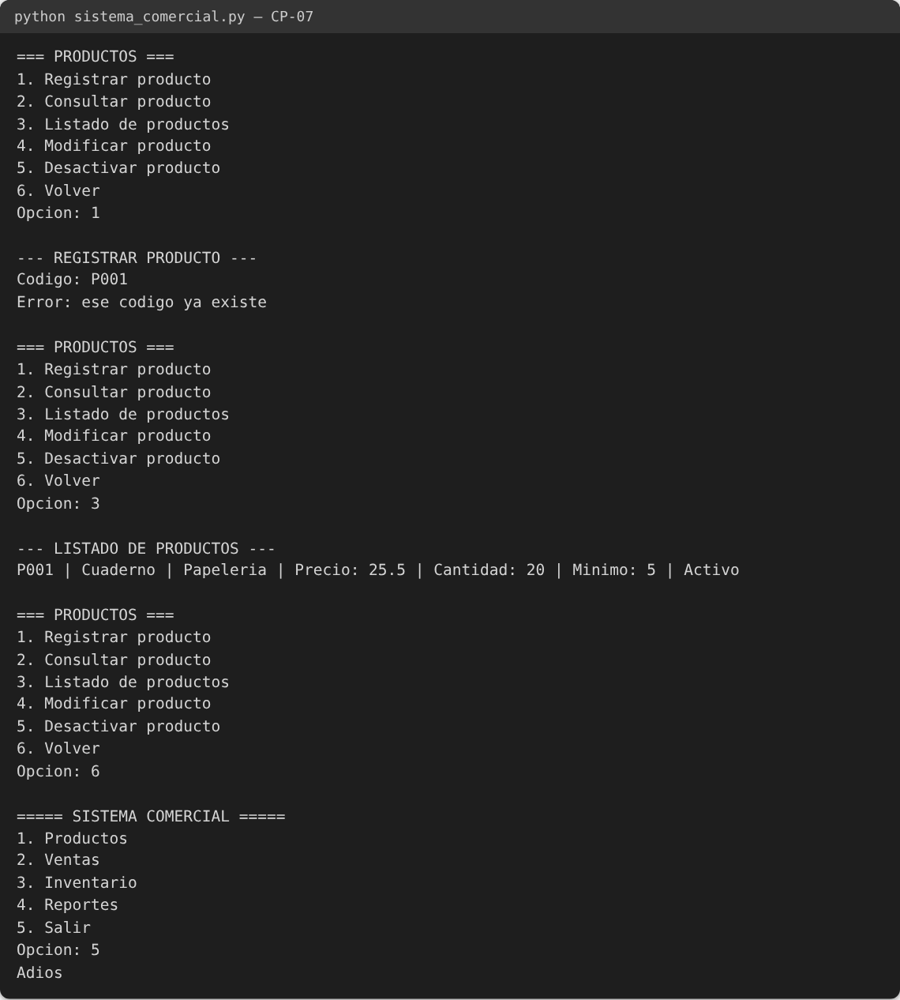

### CP-08 - Ingresar precio y cantidad negativos

- **Datos utilizados:** Precio -10 (luego 25.5); cantidad -3 (luego 20)
- **Resultado esperado:** El sistema muestra “Error: no puede ser negativo” en cada caso, vuelve a pedir el dato y solo guarda los valores válidos.
- **Resultado obtenido:** El mensaje “Error: no puede ser negativo” apareció 2 veces y se volvió a pedir el dato. Producto guardado = [['P001', 'Cuaderno', 'Papeleria', 25.5, 20, 5, True]].
- **Conclusión:** Cumple. Los valores negativos fueron rechazados y el producto se guardó solo con datos válidos.

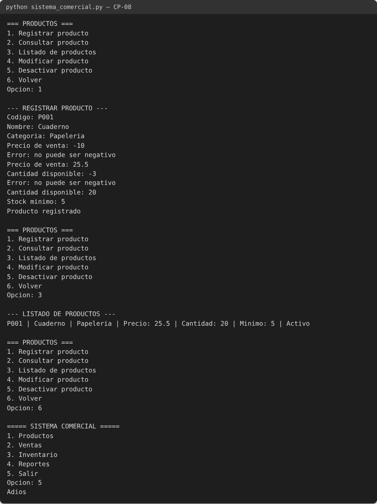

### CP-09 - Ingresar datos de tipo incorrecto

- **Datos utilizados:** Precio “abc” (luego 25.5); cantidad “diez” (luego 20); stock mínimo “5.5” (luego 5)
- **Resultado esperado:** El sistema muestra un mensaje de error por cada texto o decimal no permitido, vuelve a pedir el dato y no se cierra.
- **Resultado obtenido:** Se mostró “Error: escriba un numero” 1 vez (precio) y “Error: escriba un numero entero” 2 veces (cantidad y stock). Producto guardado = [['P001', 'Cuaderno', 'Papeleria', 25.5, 20, 5, True]].
- **Conclusión:** Cumple. El programa no falló con datos de tipo incorrecto y pidió el dato otra vez.

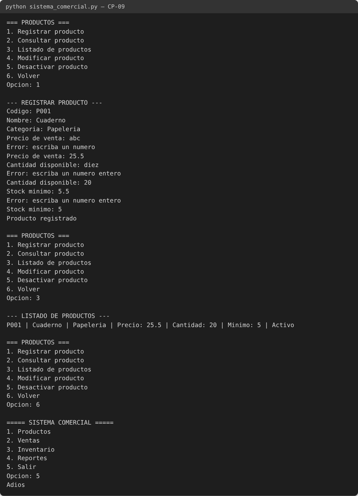

### CP-10 - Intentar vender más unidades de las disponibles

- **Datos utilizados:** P001 con 20 unidades; se intenta P001 × 25; luego P001 × 15 (válido) y P001 × 10 (15 + 10 supera 20); confirma con “s”
- **Resultado esperado:** Se rechazan P001 × 25 y P001 × 10 con “no hay suficiente inventario”; solo se vende P001 × 15: subtotal 382.5, IVA 45.9, total 428.4; la existencia queda en 5.
- **Resultado obtenido:** El mensaje “no hay suficiente inventario. Disponible: 20” apareció 2 veces. Solo se vendieron 15 unidades: Total: Q 428.4. Venta guardada = [[1, '2026-11-01', 382.5, 45.9, 428.4]]. Existencia final de P001 = 5.
- **Conclusión:** Cumple. El sistema impidió vender más de lo disponible, incluso sumando lo que ya estaba en el carrito.

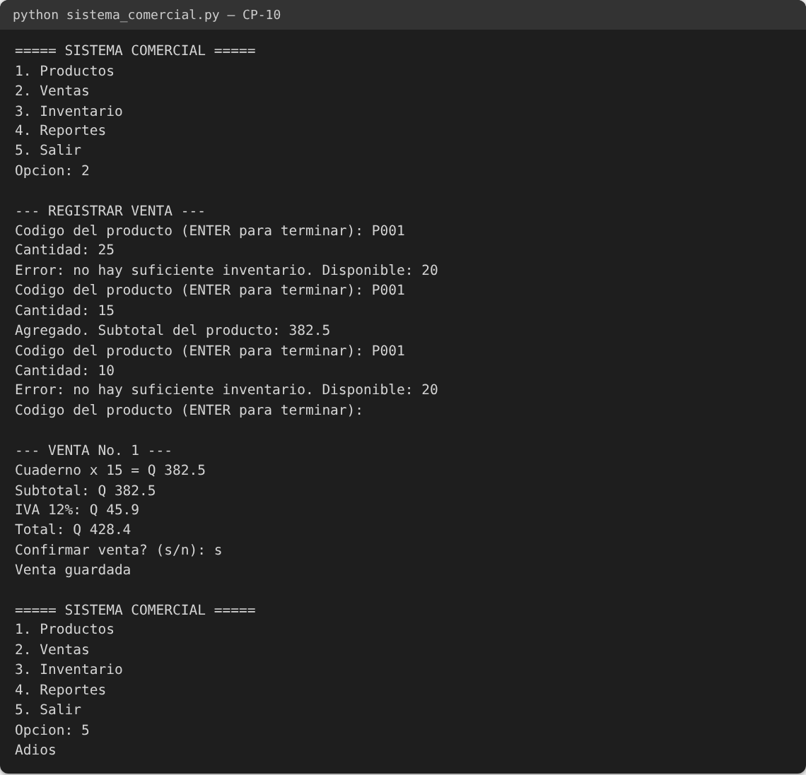

### CP-11 - Consultar un producto inexistente

- **Datos utilizados:** Lista de productos vacía; código a consultar: P999
- **Resultado esperado:** El sistema muestra “El producto no existe” y regresa al menú sin errores.
- **Resultado obtenido:** Mensaje: “El producto no existe”. La lista de productos sigue vacía = [].
- **Conclusión:** Cumple. Un código inexistente se maneja con un mensaje y el programa continúa.

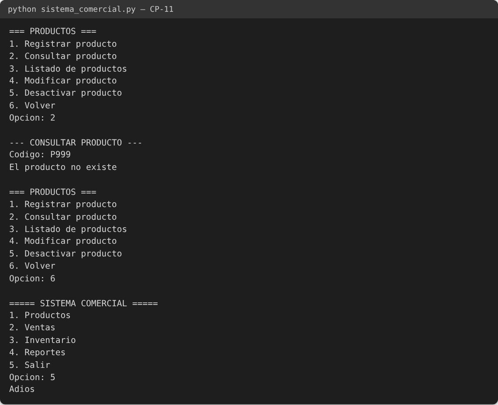

### CP-12 - Intentar vender un producto desactivado

- **Datos utilizados:** P001 desactivado con la opción 5; se intenta vender P001
- **Resultado esperado:** El sistema muestra “Error: el producto esta desactivado”, no se registra ninguna venta y la existencia sigue en 20.
- **Resultado obtenido:** Mensaje: “Error: el producto esta desactivado”. Ventas = []. Existencia de P001 = 20. Activo = False.
- **Conclusión:** Cumple. Un producto desactivado no se puede vender y su información se conserva.

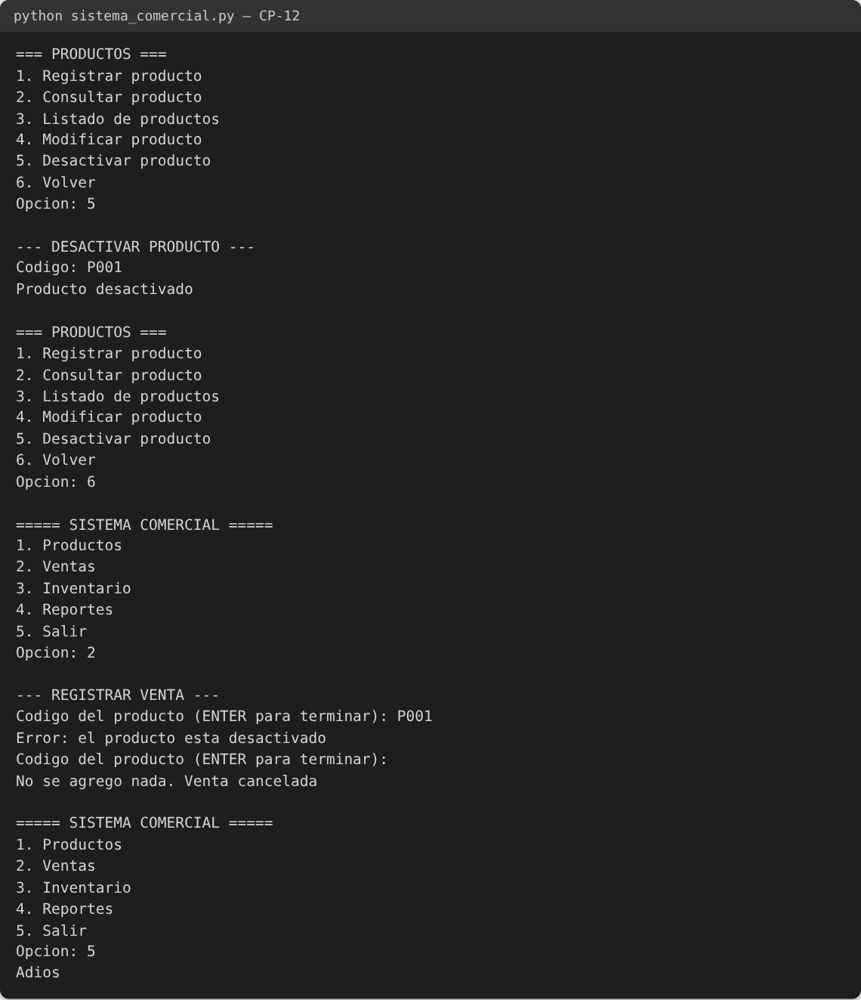

### CP-13 - Elegir una opción inválida en los menús

- **Datos utilizados:** Menú principal: 9, abc y vacío (solo ENTER); menú de productos: x
- **Resultado esperado:** El sistema muestra “Opcion invalida”, vuelve a mostrar el menú y no se cierra; al final sale con la opción 5.
- **Resultado obtenido:** El mensaje “Opcion invalida” apareció 4 veces (3 en el menú principal y 1 en el de productos). El programa siguió funcionando y terminó con “Adios”.
- **Conclusión:** Cumple. Una opción inválida no termina el programa y la salida es controlada.

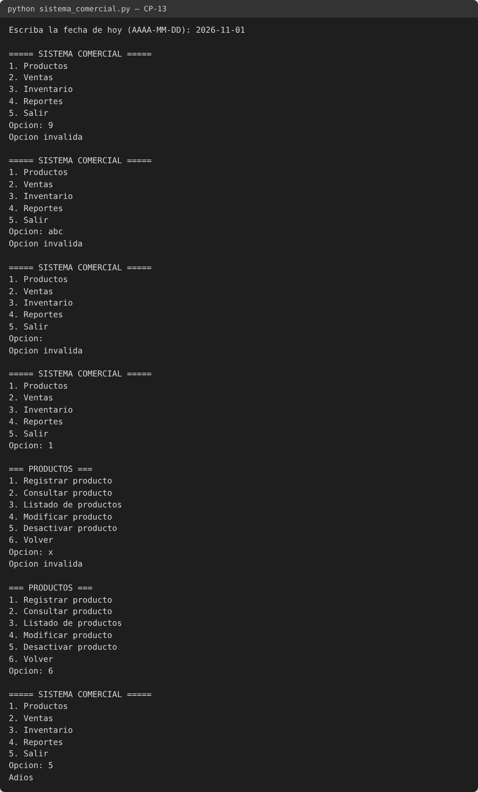

### CP-14 - Venta cancelada y carrito vacío

- **Datos utilizados:** Venta 1: P001 × 3 y respuesta “n” a la confirmación; venta 2: ENTER sin agregar productos
- **Resultado esperado:** En ambos casos no se registra venta, la existencia sigue en 20 y no se crean movimientos nuevos.
- **Resultado obtenido:** Mensajes “Venta cancelada” (confirmación n) y “No se agrego nada. Venta cancelada” (carrito vacío). Ventas = []. Existencia de P001 = 20. Movimientos = 1 (solo el inventario inicial).
- **Conclusión:** Cumple. Las ventas canceladas no modifican el inventario ni los registros.

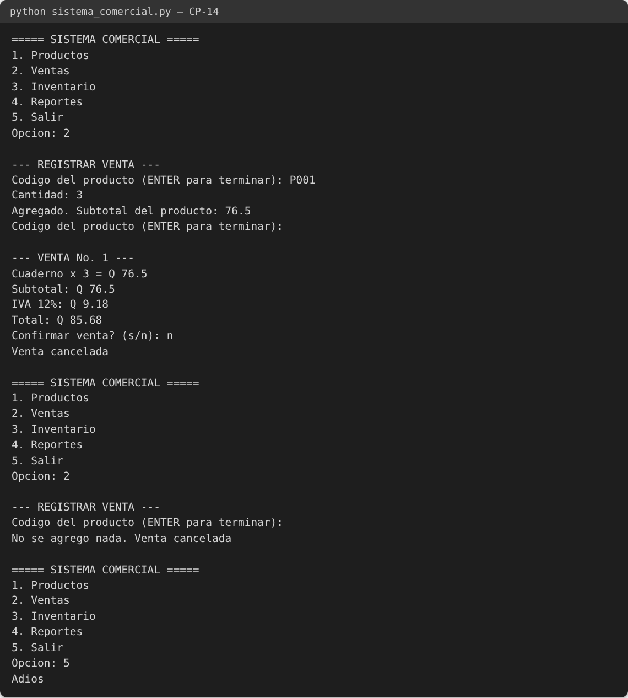

### CP-15 - Reportes de ventas: historial, total de ingresos y producto más vendido

- **Datos utilizados:** P001 (25.5, 20 unidades) y P002 (2.75, 3 unidades). Venta 1: P001 × 4 y P002 × 1. Venta 2: P001 × 6. Reportes 3, 4 y 5
- **Resultado esperado:** Venta 1: subtotal 104.75, IVA 12.57, total 117.32. Venta 2: subtotal 153.0, IVA 18.36, total 171.36. Total de ingresos = 288.68. Más vendido: P001 con 10 unidades.
- **Resultado obtenido:** Historial: Venta 1 | 2026-11-01 | Subtotal: 104.75 | IVA: 12.57 | Total: 117.32 ; Venta 2 | 2026-11-01 | Subtotal: 153.0 | IVA: 18.36 | Total: 171.36. Total de ingresos: Q 288.68. Más vendido: Codigo del producto: P001, Unidades vendidas: 10.
- **Conclusión:** Cumple. Los reportes se calculan con los datos guardados y coinciden con el cálculo manual.

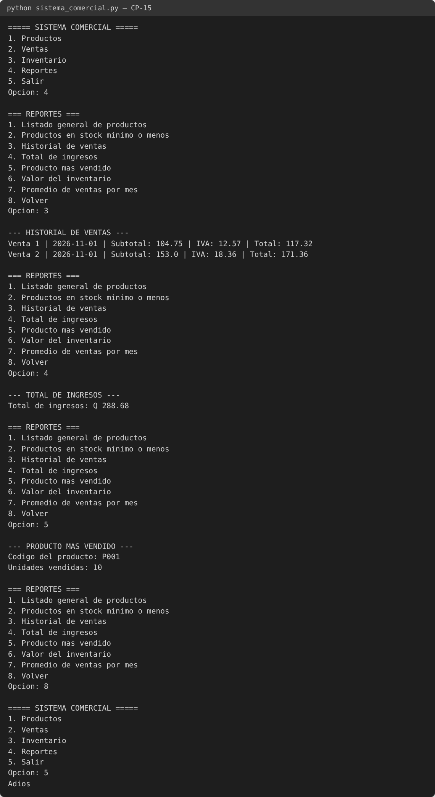

### CP-16 - Reportes de inventario: listado, stock mínimo, valor del inventario y promedio por mes

- **Datos utilizados:** Mismos datos del caso anterior (después de las dos ventas). Reportes 1, 2, 6 y 7
- **Resultado esperado:** Existencias: P001 = 10 y P002 = 2. Stock mínimo: solo P002 (2 ≤ 5). Valor del inventario = 10 × 25.5 + 2 × 2.75 = 260.5. Promedio por mes (un solo mes, 2026-11) = 288.68.
- **Resultado obtenido:** Stock mínimo: P002 | Lapiz | Cantidad: 2 | Minimo: 5 (P001 no aparece). Valor total: Q 260.5. Mes 2026-11 : Q 288.68; Promedio por mes: Q 288.68. Existencias: P001 = 10, P002 = 2.
- **Conclusión:** Cumple. El valor del inventario, la alerta de stock mínimo y el promedio coinciden con el cálculo manual.

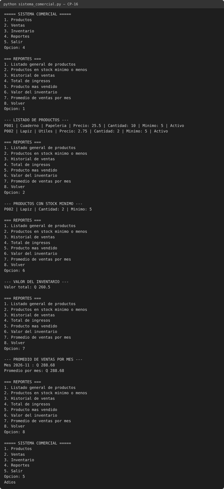

### CP-17 - Verificación directa de los cálculos con datos de dos meses

- **Datos utilizados:** 3 ventas (octubre: 100.0 y 50.0; noviembre: 30.0); 3 productos con P003 desactivado; 3 renglones de detalle de ventas
- **Resultado esperado:** Ventas por mes: 2026-10 = 150.0 y 2026-11 = 30.0; promedio por mes = 90.0; total de ingresos = 180.0; valor del inventario = 110.0 (sin el producto desactivado); producto más vendido: P002 con 7 unidades.
- **Resultado obtenido:** calcular_ventas_por_mes = (['2026-10', '2026-11'], [150.0, 30.0]); calcular_promedio = 90.0; calcular_total_ingresos = 180.0; calcular_valor_inventario = 110.0; calcular_unidades_por_producto = (['P001', 'P002'], [5, 7]); producto con mas unidades vendidas = P002.
- **Conclusión:** Cumple. Las funciones de cálculo agrupan por mes, promedian, suman y excluyen productos desactivados correctamente.

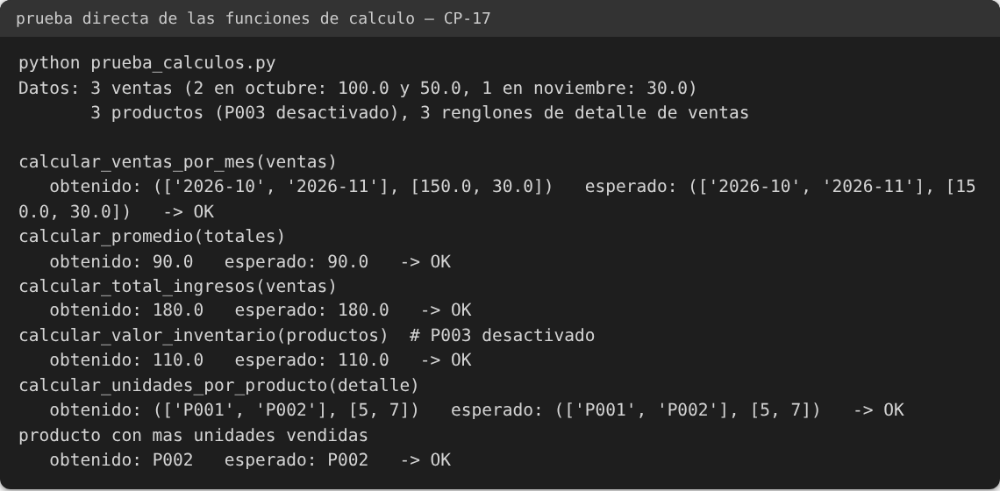
